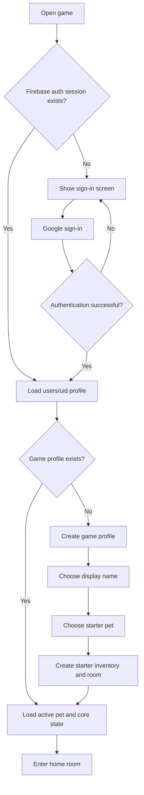
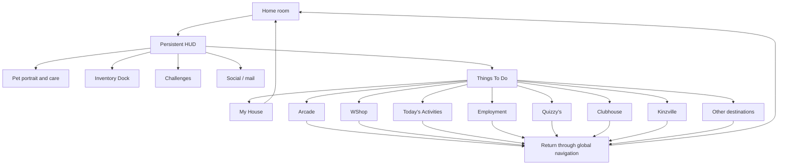
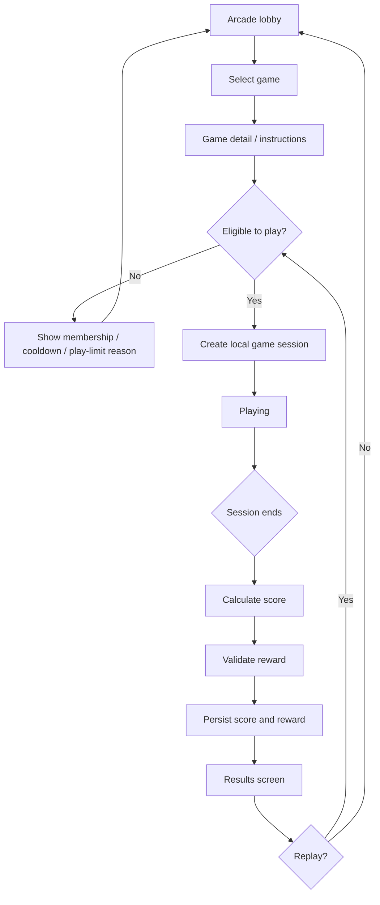
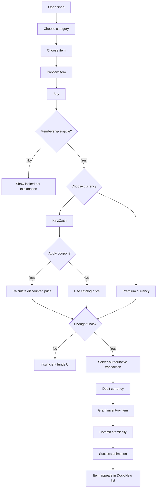
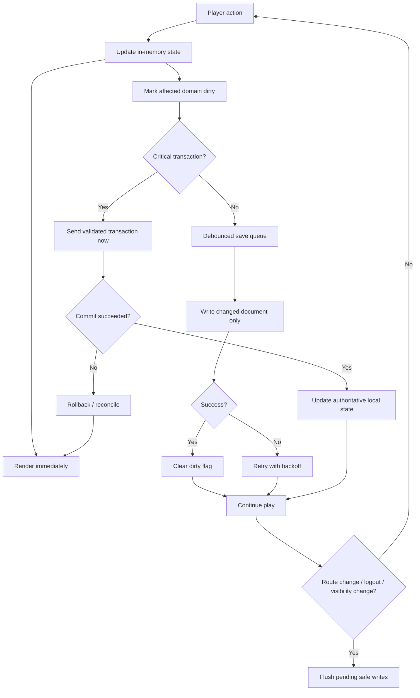

# Webkinz Classic Interface and Gameplay Technical Feature Specification

## Executive summary

Webkinz Classic is best understood not as a collection of independent mini-games, but as a **persistent virtual-pet world wrapped in a global application shell**. The player's pet, inventory Dock, currencies, pet-care status, navigation, friends/mail, challenges, and notifications remain conceptually present while the player moves among rooms, shops, games, social spaces, and scheduled activities. Official Webkinz documentation identifies the long-lived core as pet adoption and care, room customization, Arcade games, shopping, daily activities, jobs, trivia, multiplayer/social spaces, and a persistent KinzCash economy. citeturn27view0turn27view1turn28view1

The most useful design reference for a modern adaptation is the **Webkinz X interface redesign introduced in 2015**. Its room shell places room controls at upper left, currencies and progression at top center, social/mail/settings at upper right, pet status and inventory along the bottom, and a universal Things To Do launcher at lower right. The Dock uses category tabs and dynamically loads inventory, while Things To Do expands into a grid of destinations with persistent shortcuts for My House, Arcade, and WShop. citeturn23view0turn25view0turn25view1


Official Webkinz X room screenshot. The major pattern to copy is the persistent HUD surrounding a large interactive world viewport, not the copyrighted artwork itself. citeturn24view0turn23view0

A modern vanilla-JavaScript adaptation should preserve that architecture but implement it with **semantic HTML for application controls and screens, inline SVG for interactive illustrated objects and pets, CSS transforms/animations for lightweight motion, and Canvas only for high-frequency transient rendering such as particles or action-heavy mini-games**. Historically, Webkinz Classic was built around Adobe Illustrator art, Flash, multiple generations of ActionScript, and a custom 2D skeletal character system. Public documentation does not establish that the modern browser port internally uses SVG or Canvas, so SVG/Canvas recommendations below are an adaptation strategy, not a claim about the original renderer. citeturn23view5turn20search21

The game's strongest retention loop is:

```text
Return
  ↓
Check pet
  ↓
Complete care request / daily activity
  ↓
Receive currency, score or item
  ↓
Play game / job / activity
  ↓
Earn more currency
  ↓
Buy or unlock item
  ↓
Decorate room / dress pet
  ↓
Progress collection
  ↓
Return when timers and daily activities reset
```

Pet Care Hearts, daily activities, employment cooldowns, rotating shop inventory, daily wheels, challenges, and scheduled events layer multiple time horizons onto this loop. The Pet Care Heart, for example, increases through feeding, bathing, grooming, exercise, play and requests, then drops 25 points after midnight; filling it contributes bonus KinzCash and Family Score but does not determine whether the pet survives. Employment is limited to one job every eight hours, with additional Deluxe benefits. citeturn28view0turn28view3turn24view1

A clone or adaptation should **not begin by reproducing the entire Webkinz feature catalog**. The highest-value first version is: global shell, one pet, pet care, a room, inventory Dock, room decoration, Things To Do navigation, a WShop-style store, several Arcade mini-games, daily rewards, challenges, and robust saving. Social features, live multiplayer, trading, premium currency, large activity maps, and dozens of secondary destinations should follow only after the core loop feels rewarding.

There is also an important historical lesson. Webkinz accumulated an enormous number of destinations over time. Its own 2015 redesign reorganized navigation into thematic columns, while developer commentary has discussed the difficulty of maintaining the legacy Classic codebase. For a new implementation, use **one reusable screen router and reusable system components**, rather than building every destination as a special-case application. citeturn25view1turn23view5

### Primary research links

The most useful official references are:

- Official Classic FAQ: https://webkinznewz.ganzworld.com/announcements/help/ citeturn27view3
- Official Webkinz A-Z interface glossary: https://www.webkinz.com/us_en/pa_glossary.html citeturn27view0
- Official browser-version status: https://webkinznewz.ganzworld.com/browser-version/ citeturn23view4
- Webkinz X room redesign: https://webkinznewz.ganzworld.com/announcements/webkinz-x-revealed-the-new-room/ citeturn23view0
- Webkinz X Dock redesign: https://webkinznewz.ganzworld.com/announcements/webkinz-x-revealed-the-new-dock/ citeturn25view0
- Webkinz X Things To Do redesign: https://webkinznewz.ganzworld.com/announcements/webkinz-x-revealed-new-things-to-do-menu/ citeturn25view1
- Official Webkinz YouTube channel: https://www.youtube.com/webkinz citeturn6search1
- Wayback collection for historical Webkinz pages: https://web.archive.org/web/*/http://www.webkinz.com/ citeturn7search2
- Historical 2007 Webkinz homepage image preserved with a developer retrospective: https://www.360kid.com/blog/images/webkinz_200704_540.jpg citeturn17view0

The latest official browser-status page I found is still labeled **October 14, 2025**. It says the browser version and desktop app share the same account data, but lists several browser-specific omissions and bugs. Official 2026 event posts confirm that the browser version remains actively usable, so treat the 2025 compatibility list as a documented baseline, not proof that every listed limitation remains unresolved in October 2026. citeturn23view4turn20search6turn20search12turn20search15

## Interface catalog and UI architecture

### The persistent application shell

The canonical Classic layout is a **viewport surrounded by global controls**. The 2015 official room redesign documented the following arrangement: room map, zoom, challenge visibility and edit mode at upper left; KinzCash, eStore Points, filled hearts and Family Score at top center; KinzTime, friends, KinzPost, Message Center and options at upper right; pet portrait/meters and the Dock across the bottom; and Things To Do at lower right. citeturn23view0

For your existing DOM/SVG/Canvas stack, the shell should be structurally similar to:

```html
<div id="game-shell">
  <header class="top-hud">
    <nav class="room-tools" aria-label="Room controls"></nav>

    <section class="account-status" aria-label="Account status">
      <output data-bind="kinzCash"></output>
      <output data-bind="premiumCurrency"></output>
      <button data-action="family-score"></button>
    </section>

    <nav class="social-tools" aria-label="Social and account tools"></nav>
  </header>

  <main id="screen-host" tabindex="-1">
    <!-- Router mounts the current screen here -->
  </main>

  <aside id="challenge-stack" aria-label="Current challenges"></aside>

  <section id="pet-hud" aria-label="Active pet"></section>

  <nav id="inventory-dock" aria-label="Inventory"></nav>

  <nav class="global-shortcuts" aria-label="Main destinations">
    <button data-route="house">Home</button>
    <button data-route="arcade">Arcade</button>
    <button data-route="shop">Shop</button>
    <button data-action="things-to-do">Things To Do</button>
  </nav>
</div>
```

The most important architectural rule for a code agent should be:

> **Screens may replace the center viewport, but global account state, active-pet state, navigation, notifications, currency and inventory are owned by the application shell rather than individual screens.**

This prevents the common game-project failure where every destination independently implements currency counters, inventories, timers and navigation.

### Core screen hierarchy

The table below combines the official A-Z glossary, FAQ and Webkinz X navigation grid. A handful of older destinations are legacy or browser-port-dependent, but they are included because they reveal the full Classic information architecture. citeturn27view0turn27view1turn27view2turn26view1

| Screen / hierarchy | Purpose and key elements | Primary inputs | Output / state change | Recommended web pattern |
|---|---|---|---|---|
| **Entry > Login** | Username/password, login, account creation, password recovery/change | Credentials | Session/account loaded | `<main><form>` with native labels and validation |
| **Entry > New account** | Create free account, account identity, initial setup | Account data | User/profile created | Multi-step semantic `<form>` |
| **Entry > Adoption Center** | Adopt free or coded pet; pet name/profile; adoption reward | Adoption code, pet choices | New pet, rewards, possibly room/membership | `<section>` + wizard `<dialog>` |
| **Entry > Parent/account controls** | Recovery information and parental social permissions | Parent/recovery settings | Account-policy state | Separate protected settings screen |
| **Shell > My House / Room** | Primary pet/world space; pet, furniture, doors, room interactions | Click, drag/drop, item use | Pet state, room layout, inventory | HTML HUD + inline SVG room + Canvas FX |
| **Shell > House Map** | Select, arrange and enter owned rooms | Room selection/repositioning | `activeRoomId` | SVG/map grid with HTML buttons |
| **Shell > Dock** | Persistent inventory; category tabs, item drag-out | Tab, scroll, drag, select | Selected/moved/used item | `role="tablist"` + virtualized item list |
| **Shell > Things To Do** | Universal destination menu grouped by theme | Destination click | Route transition | `<dialog>` or overlay grid of buttons |
| **Shell > Challenges** | Time/event tasks and progress | Activity completion | Task progress, reward | Collapsible `<aside>` cards |
| **Shell > Pet HUD** | Portrait, pet selection, needs and request timer | Pet click/action | Active pet, care changes | Semantic `<section>` with SVG meters |
| **Shell > Family Score** | Long-term account progression and milestone rewards | Pet care | Score/milestone unlock | Progress component + reward modal |
| **Shell > Friends phone** | Friends, status, invitations, Do Not Disturb | Add/select/invite | Friend/request/presence state | Popover or side panel |
| **Shell > KinzPost** | Letters/packages between friends | Recipient, content, gift | Mail object, inventory transfer | Inbox/outbox panels |
| **Shell > Message Center** | System notifications | Open/dismiss | Read status | Notification drawer |
| **Shell > Options** | Settings/help/account functions | Toggle/select | Preferences/account actions | `<dialog>` settings panel |
| **Pet > My Pets** | Pet collection, biography, certificate and status | Select pet | `activePetId` | Card/grid browser |
| **Pet > Dress Your Pet** | Equipment/outfits and Pet Buddies | Drag/click clothing | Equipped slots | Character SVG + equipment grid |
| **Pet > Care interactions** | Food, bed, bath, sink, exercise, toys | Item/environment interaction | Needs/heart/request progress | Reusable action component |
| **Economy > WShop** | Main catalog, categories, preview, buy/sell, coupons | Category/item/buy/sell | Currency and inventory | Category nav + product grid + purchase dialog |
| **Economy > KinzStyle Outlet** | Clothing-specific shop | Purchase/equip | Currency/inventory | Shared shop component with catalog filter |
| **Economy > Curio Shop** | Rotating merchandise, rare items, Gem Hunt | Buy/mine | Currency/item/gem | Shop template + activity subview |
| **Economy > Wish Factory** | Spend Wish Tokens on exclusives | Item/token selection | Tokens decrease, item granted | Redemption catalog |
| **Economy > Code Shop** | Redeem feature codes | Code | One-time reward | Protected code form |
| **Economy > eStore hooks** | Premium purchase/access | Premium currency | Premium entitlement/item | Purchase modal, not separate game state |
| **Activities > Arcade** | Browse/launch mini-games | Game selection | Game session | `<section class="game-grid">` |
| **Activities > Arcade game** | Game instructions, gameplay HUD, score/result | Keyboard/pointer/touch | Score, currency, records | Canvas/SVG game surface + HTML HUD |
| **Activities > Today's Activities** | Scheduled events, bonuses, coupons and daily activities | Claim/play/visit | Daily flag or reward | Timeline/card dashboard |
| **Activities > Employment Office** | Job board, requirements and cooldown | Job selection/gameplay | KC, job progression, cooldown | Board/card UI + mini-game route |
| **Activities > Quizzy's Corner** | Trivia for KinzCash | Answer | Answer state + KC | HTML question/choice UI |
| **Activities > Kinzville Academy** | Pet classes and skill progression | Class selection/performance | Pet skill/stat progression | Course grid + mini-game |
| **Activities > Tournament Arena** | Score tournaments and player-vs-player play | Game/opponent | Tournament score/result | Lobby + match state |
| **Activities > Magical Forest** | Collection/randomized sub-activities | Play/select | Collection/reward/play counter | Map/subactivity router |
| **Activities > Vacation Island** | Premium/destination activities | Location/activity | Rewards/activity state | Destination map |
| **World > Kinzville Map** | Decoratable world map and destination launcher | Move objects/click buildings | Map decoration/route | SVG map + separate map-item Dock |
| **Social > Clubhouse lobby** | Choose social room and locate friends | Room selection | Social room session | Room cards/list |
| **Social > Clubhouse room** | Avatar presence, chat, friend requests and interactables | Chat/action/select user | Chat/social events | SVG scene + HTML chat/roster |
| **News > Newspaper/Newz** | Announcements/events/content | Article selection | Mostly none | Standard HTML content |
| **Secondary/legacy** | Park, Stadium, Adventure Park, Music Starz, MAZIN' Hamsters, My Page | Feature-specific | Feature-specific | Lazy-loaded modules rather than shell code |

The official Things To Do redesign provides a useful canonical map of the Classic-era feature breadth. It includes Adoption Centre, My House, Arcade, WShop, Today's Activities, Kinzville, Newspaper, Employment Office, Clubhouse, Tournament Arena, KinzStyle Outlet, Magical Forest, MAZIN' Hamsters, Webkinz Newz, Academy, Park, Stadium, Curio Shop, Vacation Island, Music Starz, KinzPost, announcements, Adventure Park, Quizzy's, eStore, Wish Factory, Code Shop and My Page. citeturn25view1turn26view1


The key pattern is **recognition over recall**: every destination has a large illustrated icon, short label, color-coded tile and consistent grid position. Three high-frequency destinations are also exposed as permanent shortcuts instead of forcing the player through the grid each time. citeturn25view1

### Inventory Dock

The official redesign replaced a sorting dropdown with tabs and organized items first by type and then alphabetically. Documented categories include All, Special, Food, Clothing, Furniture, Decorations and Pet Actions. Inventory is loaded dynamically rather than through an explicit "get item from storage" operation. citeturn25view0turn25view2


A close modern adaptation would be:

```html
<section class="dock">
  <div role="tablist" aria-label="Inventory categories">
    <button role="tab" data-filter="all">All</button>
    <button role="tab" data-filter="special">Special</button>
    <button role="tab" data-filter="food">Food</button>
    <button role="tab" data-filter="clothing">Clothing</button>
    <button role="tab" data-filter="furniture">Furniture</button>
  </div>

  <button data-action="previous-page" aria-label="Previous inventory items"></button>

  <div class="dock-items" role="list">
    <!-- Render visible inventory entries -->
  </div>

  <button data-action="next-page" aria-label="Next inventory items"></button>
</section>
```

Do **not** render several thousand inventory elements into the DOM at once. Render a page/window of items, reuse nodes, and keep canonical inventory state in JavaScript.

The Dock should distinguish three concepts:

```text
Catalog item
"Blue Sofa"
       ↓
Inventory instance or stack
"Player owns 2 Blue Sofas"
       ↓
Placed/equipped instance
"Sofa instance 872 is in room bedroom-1 at tile 4,6"
```

That distinction becomes critical for room saving, gifting, trading and duplicate items.

### Room interaction model

Official documentation describes dragging room items from the Dock and using a green placement indicator to show legal placement. Webkinz X also introduced an explicit edit mode, long-click entry into editing, zoom controls and automatic recovery of stuck/misplaced room items back to the Dock on room reload. citeturn27view2turn23view0

For your stack, represent room furniture as data-backed visual objects rather than hand-coded markup:

```html
<svg class="room-scene" viewBox="0 0 1200 760">
  <g id="floor"></g>

  <g id="furniture">
    <g
      class="room-object"
      data-instance-id="obj_872"
      data-item-id="blue_sofa"
      transform="translate(480 310)"
      tabindex="0"
      role="button"
      aria-label="Blue sofa"
    >
      <!-- paths/use elements -->
    </g>
  </g>

  <g id="pet-layer"></g>
</svg>

<canvas class="room-particles" aria-hidden="true"></canvas>
```

Use a **logical coordinate system** independent of screen pixels:

```js
{
  instanceId: "obj_872",
  itemId: "blue_sofa",
  roomId: "bedroom_1",
  tileX: 4,
  tileY: 6,
  rotation: 1,
  layer: 18
}
```

That gives you deterministic collision checks, save/load, responsive scaling and keyboard movement.

## Navigation, account and transactional flows

### Account login and initial profile

Classic currently exposes free account creation and normal login; official support material describes the free account as the base tier, with pet adoption or Deluxe membership expanding access. Recovery information and parental controls are separate account-management concerns. citeturn28view1turn27view4turn27view6

For your Firebase/Google-sign-in adaptation, separate **identity** from **game identity**. Firebase Authentication should establish the user, while the player's public display name, pet names and game profile live in Firestore. That avoids making a visible game username the authentication credential.



For a Webkinz-like feel, the starter-pet sequence should be a celebratory **adoption ceremony**, not merely a settings form. Classic's adoption system treats a pet as an account-expanding collectible and historically awards pet-specific and adoption rewards. Official support also says the first ten adopted pets can produce a free medium room, while certain adoption milestones produce Super Beds. citeturn27view3turn28view1

### Home and global navigation

The Things To Do menu is available throughout the Classic interface, while My House, Arcade and WShop were promoted to permanent shortcuts in the Webkinz X redesign. citeturn25view1



Implementation recommendation: use one route registry rather than hard-coded button handlers.

```js
const routes = new Map([
  ["house", loadHouseScreen],
  ["arcade", loadArcadeScreen],
  ["shop", loadShopScreen],
  ["daily", loadDailyActivities],
  ["jobs", loadEmploymentOffice],
  ["clubhouse", loadClubhouse]
]);

export async function navigate(routeId, params = {}) {
  const loader = routes.get(routeId);
  if (!loader) throw new Error(`Unknown route: ${routeId}`);

  await saveDirtyState();
  return loader(params);
}
```

### Entering an Arcade mini-game

The Arcade is officially a game hub where games generate KinzCash, and Tournament Arena provides score tournaments and multiplayer competition. The game-specific rules vary, so the useful reusable abstraction is selection, instructions, session, results and reward. citeturn27view0turn27view2



A mini-game module should expose a narrow interface so the rest of the application never needs to know its internal implementation:

```js
export const gameDefinition = {
  id: "leaf-catch",
  title: "Leaf Catch",
  inputMode: "keyboard-pointer",

  createSession(context) {},
  start() {},
  pause() {},
  resume() {},
  destroy() {},

  getResult() {
    return {
      score: 0,
      durationMs: 0,
      achievements: []
    };
  }
};
```

Do not let a mini-game directly mutate KinzCash. Return a result to the economy/progression layer.

### Purchasing an item

Official WShop flow is category -> subsection -> item -> optional preview -> buy -> item added to Dock. Coupons can be supplied at checkout for eligible KinzCash purchases, and eStore Points provide a separate premium-currency path. citeturn28view2turn28view6



The client can calculate a **preview price**, but the final price and reward should be validated against trusted catalog data before committing. That matters especially if there is premium currency, gifting, trading, leaderboards or competition.

### Saving progress

The current browser version and desktop version share the same Webkinz account data, confirming Classic's basic conceptual model of server-persisted account state rather than device-local saves. The actual Webkinz backend schema is not public, so the following is a recommended architecture rather than a reverse-engineered one. citeturn23view4



Use **immediate writes** for purchases, reward claims, code redemption and social transfers. Use **debounced writes** for low-risk UI state such as room-object movement, selected tabs and preferences. Never wait for logout to save an entire game session.

## Gameplay systems, economy and social mechanics

### Pet system

Classic intentionally keeps the selected pet visually present across much of the experience. Its long-standing pet-state systems include Happiness, Health and Hunger, and later the Pet Care Heart. The official A-Z guide explicitly states that pets do not die even if the traditional meters become low. citeturn27view1turn28view3

A useful state model is:

```text
Pet
├── Identity
│   ├── species
│   ├── name
│   ├── adoption date
│   └── cosmetic configuration
├── Care
│   ├── hunger
│   ├── happiness
│   ├── health
│   └── careHeart
├── Progression
│   ├── academy stats
│   ├── care history
│   └── request difficulty/unlocks
└── Equipment
    ├── clothing slots
    └── buddy/accessory
```

Classic's Pet Care Heart has particularly clear rules: routine pet care and play increase it, responding to a pet request is the fastest documented way to increase it, it only rises while playing during the day, and every day after midnight the value drops by 25 points. Filling hearts contributes bonus KinzCash and Family Score. citeturn28view3turn24view1

| Pet mechanic | Trigger | State change | Time rule | Suggested state machine |
|---|---|---|---|---|
| Feed | Food item used on pet | Hunger, care contribution | Immediate | `idle -> eating -> idle` |
| Bath/groom | Interact with care object | Care meters/heart | Immediate or short animation | `idle -> careAction -> idle` |
| Exercise | Treadmill/trampoline/etc. | Care contribution | Action-based | `idle -> exercising -> idle` |
| Play | Toy/game interaction | Happiness/care | Action-based | `idle -> playing -> idle` |
| Pet request | Request generated | Temporary objective | Timed request | `none -> active -> completed/expired` |
| Care Heart | Valid care action | Heart increases | Loses 25 after midnight | `partial -> full -> next-day partial` |
| Family Score | Care/progression event | Account score increases | Persistent | Monotonic progression |

Pet requests can become more specific as a pet has been played with more and its heart filled more often, according to the official FAQ. That makes them useful as a progressive tutorial mechanism: early requests can be "feed me", while later requests can send the player toward more systems. citeturn28view4

For an adaptation, requests should be data-driven:

```js
{
  id: "pet_request_bath",
  type: "petCare",
  requirement: {
    action: "useObjectTag",
    tag: "bathtub"
  },
  expiresAfterMs: 300000,
  rewards: {
    careHeart: 15,
    xp: 10
  },
  minimumPetLevel: 1
}
```

### Rooms and decorating

The room is both a personalization system and an interaction surface. Classic lets the player buy wallpaper, flooring and furniture, drag them from the Dock, place them on valid locations and interact with functional objects. citeturn27view2turn23view0

Recommended room state machine:

```text
VIEW
  │
  ├─ click interactive object -> INTERACTION
  │                              └─ complete -> VIEW
  │
  └─ Edit -> EDIT
             ├─ select inventory item -> PLACING
             │   ├─ valid tile -> PLACE -> EDIT
             │   └─ cancel -> EDIT
             ├─ select room object -> MOVING
             ├─ rotate -> EDIT
             ├─ return to inventory -> EDIT
             └─ Done -> SAVE -> VIEW
```

Preserve three classes of room objects:

| Class | Example behavior | Renderer |
|---|---|---|
| Decorative | Rug, poster, plant | SVG or raster image |
| Stateful | Lamp on/off, opened chest | SVG with state variants |
| Interactive activity | Bed, bath, game table | SVG visual + JS interaction controller |

Room assets should not contain game logic. An object catalog can declare behaviors:

```json
{
  "id": "bathtub_cloud",
  "type": "furniture",
  "footprint": [2, 2],
  "orientations": 4,
  "interaction": {
    "type": "petCare",
    "action": "bath",
    "durationMs": 6000
  }
}
```

### Arcade and mini-games

Classic uses mini-games as both entertainment and a major currency faucet. Official documentation identifies the Arcade as a source of KinzCash and high scores, while the Tournament Arena adds best-score competitions and head-to-head play. citeturn27view0turn27view2

Rather than cloning individual Classic games, implement a common result contract:

```js
{
  sessionId: "gameSession_...",
  gameId: "leaf-catch",
  startedAt: 1761232100000,
  endedAt: 1761232253000,
  score: 12400,
  rewardRequest: {
    type: "scorePayout",
    score: 12400
  }
}
```

Reusable game lifecycle:

```text
LOCKED / AVAILABLE
        ↓
INSTRUCTIONS
        ↓
COUNTDOWN
        ↓
PLAYING
   ↙         ↘
PAUSED       GAME_OVER
   ↓             ↓
PLAYING       RESULTS
                 ↓
              REWARD
                 ↓
          REPLAY / EXIT
```

Use HTML for instructions, pause, score and result overlays even when the actual game is Canvas. This keeps essential information in the accessibility tree and simplifies responsive layout.

### Scheduled and daily activities

Today's Activities is explicitly a schedule/dashboard for special activities, sales, coupons and bonus payouts. Classic's official FAQ documents scheduled bonus periods, occasional Jellybean Challenges, Super Wheel appearances and daily Wacky's Bingoz. Current 2026 Webkinz posts also continue to advertise daily prize-wheel activity. citeturn28view5turn20search18

The important UX pattern is **limited availability made visible before the player commits**:

```html
<article class="activity-card"
         data-status="available">
  
  <h3>Wheel of Fortune</h3>
  <p>Available today</p>
  <output aria-label="Time remaining">03:42:18</output>
  <button>Play</button>
</article>
```

Recommended states:

```text
UPCOMING -> AVAILABLE -> CLAIMED
    │           │
    │           └-> EXPIRED
    └--------------> EXPIRED
```

Use a server-defined reset boundary. Never determine daily eligibility solely from `new Date()` on the player's machine.

### Employment

Classic permits a job once every eight hours. Job boards also use prerequisites for some jobs, and the wider system historically contains multiple difficulty/job progression levels. citeturn28view0turn2search8

Adapt it as:

```text
AVAILABLE
   ↓ select job
CHECK_REQUIREMENTS
   ├─ fail -> LOCKED_REASON
   └─ pass
       ↓
    PLAYING
     ↙   ↘
 SUCCESS FAILURE
    ↓       ↓
 REWARD  RESULT
    \       /
     COOLDOWN
        ↓
    AVAILABLE
```

Store an absolute `nextJobAt` timestamp, not a ticking counter. The UI derives:

```js
remainingMs = Math.max(0, nextJobAt - serverAdjustedNow);
```

That survives refreshes and switching devices.

### Curio Shop and Gem Hunt

The Curio Shop combines rotating inventory with a daily collection activity. The official FAQ describes Gem Hunt as selecting among five mines and clicking three sparkling rocks on a daily attempt. citeturn19search4

This is a good model for a daily random-reward mechanic because it adds **choice theater** without needing a large game:

```text
Daily eligibility
      ↓
Choose region/mine
      ↓
Select limited targets
      ↓
Reveal result
      ↓
Keep / sell / collection progress
      ↓
Locked until reset
```

Random outcomes should be generated or validated by trusted backend logic when rewards matter.

### Quizzy's, Academy and challenges

Quizzy's provides question-based KinzCash rewards; official documentation indicates previously answered questions cannot simply be replayed indefinitely for repeated rewards. citeturn27view2turn19search4

Academy classes form pet-specific progression, with community documentation cataloging course categories such as Strength, Speed, Agility and Creativity, plus related progression/recess systems. Treat those precise course rules as secondary-source information rather than the foundational Classic shell. citeturn9search0turn9search12

Challenges are account objectives layered over other systems. Current official examples use multi-task challenges involving Arcade earnings, Wishing Well activity and Academy classes, and the Webkinz X room provides a control to hide/show challenge icons. citeturn6search2turn23view0

A general challenge definition should therefore reference events rather than poll screen state:

```json
{
  "id": "spring_challenge",
  "startsAt": "2026-04-01T04:00:00Z",
  "endsAt": "2026-05-01T04:00:00Z",
  "tasks": [
    {
      "id": "play_arcade",
      "event": "arcade.kinzCashEarned",
      "target": 200
    },
    {
      "id": "care_pet",
      "event": "pet.careCompleted",
      "target": 5
    }
  ],
  "rewardTableId": "spring_challenge_rewards"
}
```

Then gameplay can publish:

```js
events.emit("arcade.kinzCashEarned", {
  gameId,
  amount
});
```

The challenge system listens independently.

### Economy and monetization

Classic has several economically distinct asset types rather than one currency. KinzCash is earned through activities such as games, trivia and jobs and spent in shops. Wish Tokens are accumulated for Wish Factory redemptions. Coupons discount eligible KinzCash purchases. eStore Points are premium currency and can be used for items, extra activity plays and skipping Challenge tasks. citeturn27view1turn27view6turn28view2

| Economy object | Role | Sources | Sinks |
|---|---|---|---|
| **KinzCash** | Primary soft currency | Arcade, jobs, trivia, rewards | WShop, Curio Shop, other purchases |
| **eStore Points** | Premium currency | Paid/premium account mechanisms | Premium items, extra plays, challenge skips |
| **Wish Tokens** | Collection/redemption token | Rewards/events | Wish Factory exclusives |
| **Coupons** | Conditional discount instrument | Activities/rewards | WShop transaction |
| **Items** | Collection/decorative value | Purchase, reward, adoption | Placement, consumption, selling, gifting/trading where eligible |
| **Membership entitlement** | Content-access gate | Free, pet adoption, Deluxe purchase | Unlocks systems/content rather than being consumed |

Wish Factory's official FAQ says the Wish Machine accepts Wish Tokens and that at least ten are required before an exclusive item can be redeemed. citeturn27view6

Membership is a separate monetization layer. Official Webkinz material distinguishes Free, Full and Deluxe. Support states that adopting a qualifying pet grants one year of Full membership from the most recent adoption date and that repeated adoptions do not stack that period; Deluxe adds additional access beyond Full. Free membership retains access but restricts features. citeturn27view4turn27view5

For an adaptation, **do not reproduce every monetization gate**. A cleaner model is:

```text
FREE
core game + starter pet + standard activities

SUPPORTER/PREMIUM
cosmetics + extra content + convenience

Never gate:
basic saves
basic pet care
basic room ownership
essential accessibility
```

That is a design recommendation rather than a description of Webkinz.

### Social systems

Classic's social model is deliberately constrained. KinzChat uses preconstructed phrases, while KinzChat PLUS permits typed messages only through a restricted dictionary and requires parental permission for younger users. Clubhouse rooms expose a player roster, friend requests and room switching; reporting is available for inappropriate KinzChat PLUS behavior. citeturn27view0turn27view1turn27view6

Friends also have presence-like states. Official documentation describes green/yellow states and a Do Not Disturb mode in which the player can still initiate invitations but cannot receive them. Free accounts have a documented friends-list limit, while Full accounts are not subject to that same limit in the FAQ. citeturn27view6

A modern social state should resemble:

```json
{
  "status": "online",
  "activity": "arcade",
  "allowInvites": false,
  "chatMode": "preset",
  "lastPresenceAt": "2026-10-23T18:42:00Z"
}
```

Firestore does **not** natively implement connection presence. Firebase's own documentation recommends Realtime Database for online/offline connection state, optionally synchronizing presence information into Firestore. citeturn29view5

For a school-oriented or youth-oriented adaptation, preset messages are dramatically simpler to moderate than arbitrary free text:

```js
const allowedMessages = [
  "Hi!",
  "Want to play a game?",
  "Nice room!",
  "Good game!",
  "See you later!"
];
```

That pattern closely mirrors the safety rationale behind Classic's constructed KinzChat. citeturn27view6

## Persistence and Firestore save specification

The following schema is **recommended for your implementation**. It does not claim to reproduce Ganz's private backend.

Firestore stores JSON-like documents in collections and supports nested maps plus subcollections. Firebase recommends nested fields for relatively fixed, small structures and subcollections for collections that grow over time. That maps well to a Webkinz-style account: keep small profile/balance/settings state in a user document, but pets, rooms, inventory, messages and game history should be separate documents or subcollections. citeturn29view0turn29view1

### Suggested collection layout

```text
/users/{uid}
    /pets/{petId}
    /rooms/{roomId}
        /objects/{objectInstanceId}
    /inventory/{inventoryId}
    /progress/{systemId}
    /challenges/{challengeId}
    /gameRecords/{gameId}
    /mail/{messageId}
    /friendships/{friendUid}

/catalog/items/{itemId}
/catalog/pets/{speciesId}
/catalog/games/{gameId}
/catalog/activities/{activityId}
/catalog/challenges/{challengeId}

/economyTransactions/{transactionId}
/rewardClaims/{claimId}

/presence/{uid}              ← preferably Realtime Database
```

### UI-to-data mapping

| UI element | Primary persisted location | Key fields | Write authority |
|---|---|---|---|
| Currency display | `/users/{uid}` | `balances.kinzCash`, `balances.premium` | Prefer trusted transaction |
| Active pet portrait | `/users/{uid}` | `activePetId` | Client |
| Pet meters | `/pets/{petId}` | `needs`, `careHeart` | Validated client/server |
| Pet request timer | `/pets/{petId}` | `activeRequest`, `expiresAt` | Prefer server-created |
| Family Score | `/users/{uid}` | `progress.familyScore` | Trusted reward path |
| Dock | `/inventory/*` | `itemId`, quantity, state | Validated |
| Room furniture | `/rooms/{id}/objects/*` | item, position, rotation | Client, constrained to owned items |
| House map | `/rooms/*` | map coordinates/type | Client |
| Daily reward | `/progress/daily` | last claim/reset keys | Server-validated |
| Employment | `/progress/employment` | job levels, `nextJobAt` | Trusted result path |
| Arcade result | `/gameRecords/{gameId}` | high score/statistics | Trusted validation for leaderboard |
| Challenge | `/challenges/{id}` | task counters, claimed | Server or validated event path |
| Friends | `/friendships/*` | status, timestamps | Multi-party controlled |
| Mail | `/mail/*` | sender, recipient, contents | Server-mediated if items transfer |
| Settings | `/users/{uid}` | preferences | Client |

### User document

```json
{
  "displayName": "PlayerFox",
  "createdAt": "2026-10-23T17:00:00Z",
  "activePetId": "pet_01",
  "activeRoomId": "room_01",
  "membership": {
    "tier": "free",
    "expiresAt": null
  },
  "balances": {
    "kinzCash": 1425,
    "premium": 0,
    "wishTokens": 3
  },
  "progress": {
    "familyScore": 875,
    "accountLevel": 4
  },
  "settings": {
    "music": true,
    "soundEffects": true,
    "reducedMotion": false,
    "allowInvites": true
  },
  "schemaVersion": 3
}
```

Use Firestore `Timestamp` values in production rather than storing ISO date strings as shown in these readable examples.

### Pet document

```json
{
  "speciesId": "forest_fox",
  "name": "Maple",
  "adoptedAt": "2026-10-23T17:05:00Z",
  "needs": {
    "hunger": 84,
    "happiness": 92,
    "health": 100
  },
  "care": {
    "heart": 75,
    "lastDailyDecayKey": "2026-10-23",
    "careActionsToday": 4
  },
  "activeRequest": {
    "requestId": "req_24",
    "type": "bath",
    "startedAt": "2026-10-23T18:30:00Z",
    "expiresAt": "2026-10-23T18:35:00Z"
  },
  "skills": {
    "agility": 2,
    "creativity": 1,
    "speed": 3
  },
  "outfit": {
    "hat": "item_hat_17",
    "shirt": "item_shirt_04",
    "shoes": null
  }
}
```

### Room document and object subcollection

```json
{
  "name": "Maple's Bedroom",
  "type": "indoor",
  "size": "medium",
  "wallpaperId": "wall_blue_clouds",
  "floorId": "floor_oak",
  "mapX": 3,
  "mapY": 5,
  "updatedAt": "2026-10-23T18:41:20Z"
}
```

Object:

```json
{
  "inventoryInstanceId": "inv_a82d",
  "itemId": "blue_sofa",
  "tileX": 4,
  "tileY": 6,
  "rotation": 1,
  "layer": 18,
  "state": {
    "variant": "default",
    "active": false
  }
}
```

A room with a handful of fixed objects could technically store them in one nested array, but individual object documents make sense if rooms can accumulate many objects or individual objects are updated independently. Firebase explicitly warns that expanding nested lists make documents larger and become less scalable over time. citeturn29view1

### Inventory document

```json
{
  "itemId": "blue_sofa",
  "quantity": 1,
  "location": {
    "type": "dock"
  },
  "acquiredAt": "2026-10-23T18:39:00Z",
  "source": {
    "type": "shop",
    "transactionId": "txn_e82bd"
  },
  "tradeable": true
}
```

Avoid duplicating item artwork, names and prices in every inventory instance. Keep those in authoritative catalog data:

```json
{
  "name": "Blue Sofa",
  "category": "furniture",
  "rarity": "common",
  "basePrice": 450,
  "sellPrice": 225,
  "footprint": [2, 1],
  "assetId": "furniture_blue_sofa",
  "interaction": null
}
```

### Daily-progress document

```json
{
  "dailyKey": "2026-10-23",
  "wheelClaimed": true,
  "gemHuntUsed": false,
  "loginRewardClaimed": true,
  "heartsFilled": 2,
  "job": {
    "nextAvailableAt": "2026-10-23T23:15:00Z"
  },
  "activityClaims": {
    "autumn_leaf_reward": true
  }
}
```

For daily systems, store **the reset period identifier or next eligibility timestamp**, not merely a client countdown.

### Atomic economy update

Firestore supports transactions and batched operations, which should be used where multiple pieces of state must remain consistent. citeturn29view6

A shop transaction conceptually needs to be:

```text
Read authoritative item price
        +
Read user balance
        +
Validate membership/coupon
        ↓
Is balance sufficient?
        ↓
Debit exact amount
        +
Create inventory object
        +
Record transaction
        ↓
Commit atomically
```

Never implement this as:

```js
// Insecure design
await updateDoc(userRef, {
  "balances.kinzCash": whateverTheBrowserSays
});
```

The browser is controlled by the player.

For low-value room movement, optimistic local saving is appropriate. For currency, premium entitlements, reward claims, trades, random prizes and leaderboard records, the server should be authoritative.

## Assets, rendering, responsiveness and accessibility

### Historical visual architecture versus recommended web architecture

The original game was a Flash-era product. A retrospective with Webkinz's original creative director describes Illustrator/Flash production, mixed ActionScript generations and an in-house 2D skeletal-rigging approach used for pet animation. Flash browser support ended at the end of 2020, which forced Classic to rely on a desktop application until the later browser return. citeturn23view5turn20search21

For your vanilla-ES-module architecture, translate the **visual behavior**, not the technology:

| Asset / UI type | Use | Avoid when | Recommendation |
|---|---|---|---|
| **HTML/DOM** | Buttons, menus, forms, HUD, stores, chat, inventory structure, text | Thousands of continuously moving objects | Default for UI |
| **Inline SVG** | Pets, creatures, room objects, maps, meters, icons, interactive illustrations | Extreme path counts or thousands of animated nodes | Primary art system |
| **CSS** | Transitions, hover/focus, meter changes, simple character/object motion | Complex per-frame simulation | Primary UI animation |
| **Canvas 2D** | Particles, sparkles, confetti, many transient objects, arcade scenes | Essential controls/text/accessibility content | Effects and action rendering |
| **Raster WebP/AVIF/PNG** | Background textures, highly detailed paintings, thumbnails | Objects requiring recolor/interaction at component level | Selective |
| **Audio** | Music, UI feedback, pet voices, game effects | Autoplay without user consent/preferences | Howler.js is suitable for your stack |

Canvas is explicitly designed for programmatic graphics and animation, but its drawn contents do not inherently expose semantic object information to accessibility tools. MDN therefore recommends accessible alternatives when Canvas is used for meaningful UI. citeturn20search2turn20search14turn20search17

Your current `particles.js` Canvas layer is therefore almost exactly the role I would recommend: **decorative high-frequency effects over a semantic DOM/SVG game**.

### SVG asset conventions

Use one coordinate system per asset:

```html
<svg viewBox="0 0 256 256"
     role="img"
     aria-labelledby="fox-title">
  <title id="fox-title">Maple the forest fox</title>

  <g data-part="body">...</g>
  <g data-part="head">...</g>
  <g data-part="eyes">...</g>
  <g data-part="accessory-layer">...</g>
</svg>
```

Repeated icons should use SVG symbols:

```html
<svg class="icon" aria-hidden="true">
  <use href="#icon-kinzcash"></use>
</svg>
```

For animated characters, use a modest hierarchy:

```text
pet-root
├── body
├── head
│   ├── eyes
│   ├── mouth
│   └── ears
├── front-leg-left
├── front-leg-right
├── rear-leg-left
├── rear-leg-right
└── accessories
```

Animate group transforms instead of rewriting every path.

### Animation and Canvas performance

Canvas scenes have to redraw changing pixels, and increasingly complex full-frame redraws become expensive. MDN recommends minimizing unnecessary redraw work, pre-rendering repeated primitives where useful and separating layers when appropriate. citeturn20search5turn20search8

For your particle layer:

```js
// Conceptual structure
function frame(now) {
  updateParticles(now);
  clearDirtyArea();
  drawParticles();
  requestAnimationFrame(frame);
}
```

Stop the loop when there are no particles:

```js
if (particles.length === 0) {
  animationFrameId = null;
  return;
}
```

Do not run an empty `requestAnimationFrame()` forever on every screen.

For expensive future Canvas scenes, `OffscreenCanvas` can separate rendering work from the main DOM in supported environments, including use in workers, but that optimization is not warranted for a small leaf/sparkle layer until profiling shows a real bottleneck. citeturn20search26

### Responsive behavior

There is a useful contrast between Webkinz's intended and actual responsiveness. The 2015 Webkinz X room was explicitly designed to expand to different screen sizes. The official 2025 browser-port status says the game itself had been coded to scale to different sizes, but the Things To Do menu was not scaling correctly and phones/tablets were not yet considered playable. citeturn23view0turn23view4

That suggests an important design lesson:

> **Do not make responsiveness equivalent to scaling a fixed 940×940 game canvas. Reflow the shell.**

Recommended breakpoints are behavioral rather than device-specific:

```text
Wide
top HUD
large world
full-width inventory Dock
persistent destination shortcuts

Medium
compact top HUD
world remains dominant
Dock reduces visible item count
secondary shortcuts collapse

Narrow
world fills viewport
bottom navigation becomes primary
Dock opens as drawer
Things To Do becomes full-screen sheet
status counters become compact chips
```

Use SVG `viewBox` scaling for the illustrated scene while allowing DOM controls to independently reflow.

### Accessibility target

I found no official primary-source Webkinz Classic WCAG conformance statement. The official interaction documentation instead frequently describes clicking, dragging, hovering and icon-oriented navigation, while the current browser documentation acknowledges incomplete mobile optimization. Therefore, accessibility below should be treated as an **improvement over the historical interaction model**, not a claim about Classic's behavior. citeturn28view2turn23view0turn23view4

For your adaptation, require:

**Every action must work without drag-and-drop.** A Dock object might support dragging, but keyboard users should also be able to choose:

```text
Place item
Move
Rotate left
Rotate right
Return to inventory
Interact
```

**Every visual button must be a real button.**

Bad:

```html
<div class="round-button" onclick="openShop()">
  <svg>...</svg>
</div>
```

Better:

```html
<button class="round-button"
        type="button"
        aria-label="Open shop">
  <svg aria-hidden="true">...</svg>
</button>
```

**Never paint essential HUD text exclusively into Canvas.** Canvas objects do not automatically participate in the accessibility tree like semantic HTML. citeturn20search14turn20search17

**Respect reduced-motion preferences.** The current W3C Media Queries specification defines `prefers-reduced-motion` specifically so sites can remove or replace non-essential motion for users who request it. citeturn20search7

```css
@media (prefers-reduced-motion: reduce) {
  .pet-bounce,
  .sparkle,
  .reward-pop,
  .floating-notification {
    animation: none;
    transition: none;
  }

  canvas.room-particles {
    display: none;
  }
}
```

Also include visible focus indication, accessible names for SVG art, adequate contrast, captions/text alternatives where sound communicates state, scalable text and no gameplay mechanic whose only cue is color.

### Notifications and feedback

Classic repeatedly uses visible icons, counters, timers and contextual rewards to make the world feel active: challenge icons, Pet Requests, activity schedules, currency feedback, prize wheels, messages and friend states. citeturn23view0turn28view3turn28view5

Use four notification classes:

```text
TOAST
"250 coins earned"
short-lived, non-blocking

BADGE
"3 new messages"
persists until viewed

MODAL
"You won a rare item!"
blocks only for meaningful reward moments

WORLD CUE
pet speech bubble / glowing object / challenge icon
ties task to the game world
```

Avoid modal dialogs for every reward. Reserve them for milestones and important choices.

For screen readers:

```html
<div id="game-announcer"
     class="sr-only"
     aria-live="polite">
</div>
```

Then announce high-value state changes such as "Maple's Pet Care Heart is full" rather than every particle or meter tick.

## Security, privacy and implementation priorities

### Firebase security model

Firebase explicitly recommends combining Authentication with Security Rules for user- and role-based access control. Rules can use the authenticated user's `uid` to constrain access. citeturn29view2

The minimum ownership rule should resemble:

```text
match /users/{userId} {
  allow read: if request.auth != null
              && request.auth.uid == userId;

  allow update: if request.auth != null
                && request.auth.uid == userId
                && isAllowedProfileUpdate();

  match /pets/{petId} {
    allow read: if request.auth != null
                && request.auth.uid == userId;
  }
}
```

But **ownership alone is insufficient** for an economy game. A rule such as:

```text
allow write: if request.auth.uid == userId;
```

would allow a player to use the browser console or REST API to modify their own KinzCash, inventory, score or reward fields.

Divide fields by authority:

| State | Client direct write? | Reason |
|---|---:|---|
| Music preference | Yes | No competitive/economic value |
| Current inventory tab | Yes | Cosmetic |
| Room-object position | Usually | Low-risk, validate ownership |
| Pet name | Yes, with validation | User customization |
| KinzCash balance | **No** | Economy integrity |
| Premium currency | **No** | Monetary value |
| Purchase-created item | **No** | Must correspond to transaction |
| Daily reward | **No** | Repeat-claim attack |
| Random rare reward | **No** | Client can manipulate randomness |
| High-score leaderboard | **No / validate** | Cheating |
| Trade/gift transfer | **No** | Duplication/race conditions |
| Membership entitlement | **No** | Access control |
| Challenge reward claimed | **No** | Duplicate claims |

Use trusted callable/server functions or another authoritative backend path for the right column.

### App Check and abuse protection

Firebase App Check can reject requests that do not carry valid app/device attestation and supports Cloud Firestore and other Firebase services. Firebase stresses that App Check complements Authentication rather than replacing it and that it reduces, but does not eliminate, abuse. citeturn29view4

For a public browser game:

```text
Authentication
"Who is this user?"

Security Rules
"What data may this user access?"

App Check
"Is this request plausibly coming from my app?"

Trusted economy logic
"Is this game action actually legal?"
```

All four are separate concerns.

### Test the rules

Firebase's official simulator can test authenticated and unauthenticated reads, writes and deletes against a ruleset. citeturn29view3

Your automated security suite should include attacks, not just expected behavior:

```text
User A cannot read User B's private save
User A cannot modify User B's pet
User A cannot set their KinzCash balance
User A cannot mint an inventory item
User A cannot claim the same daily reward twice
User A cannot submit an expired challenge
User A cannot transfer an item they do not own
User A cannot overwrite another player's mail
Unauthenticated client cannot access player saves
```

### Child privacy and social features

Webkinz is historically youth-oriented and explicitly provides parental controls around KinzChat PLUS. Its own materials distinguish constructed chat from restricted typed chat and require parental permission for access to the latter in applicable accounts. citeturn27view0turn27view6

For any adaptation actually directed toward children under 13, this becomes a legal/privacy design issue, not merely a moderation issue. The U.S. COPPA Rule applies to covered child-directed services and certain services with actual knowledge that they collect children's personal information. The amended rule became effective June 23, 2025, with most compliance requirements due by April 22, 2026. FTC guidance covers notice, parental consent, data minimization, parent access/deletion rights, security and retention. citeturn21search0turn22search1turn22search6

That means a youth-facing adaptation should not casually add:

```text
public profiles
open free-text chat
location
real names
birth dates
photos
voice uploads
behavioral advertising identifiers
unrestricted friend discovery
```

without determining the applicable privacy requirements. This is an area for actual legal review if the service will be offered to children.

From a technical standpoint, minimize stored identity:

```text
Firebase Auth
uid
│
├── private account record
│   └── authentication information
│
└── game profile
    ├── invented display name
    ├── pet collection
    ├── game state
    └── settings
```

Do not copy the authenticated Google email into publicly readable game-profile documents.

### Recommended feature priority

The priority below is based on which Webkinz systems form the recurring core loop, which systems provide the strongest sense of persistence, and which are disproportionately expensive or risky to implement. Classic itself centers pets, rooms, games, daily activities and its economy, while live social and the large legacy feature catalog substantially expand complexity. citeturn27view0turn28view1turn23view5

| Priority | Feature | Why it matters | Complexity |
|---|---|---|---|
| **Must build** | Persistent global game shell | Gives every screen a unified game identity | Medium |
| **Must build** | Pet + active-pet HUD | Emotional center of the experience | Medium |
| **Must build** | Pet care + requests | Generates recurring player objectives | Medium |
| **Must build** | Home room | Gives ownership/personalization | Medium |
| **Must build** | Inventory Dock | Connects rewards, shops and rooms | Medium |
| **Must build** | Room editing | Turns item acquisition into meaningful collection | High |
| **Must build** | Things To Do launcher | Makes a growing world manageable | Low |
| **Must build** | KinzCash economy | Connects nearly every activity | Medium |
| **Must build** | WShop | Converts gameplay rewards into customization | Medium |
| **Must build** | Save/load | Makes the entire loop persistent | Medium |
| **Next** | Three to five polished mini-games | Establishes repeatable currency gameplay | Medium-high |
| **Next** | Daily reward/activity system | Creates return behavior cheaply | Medium |
| **Next** | Challenges | Reuses existing systems to create goals | Medium |
| **Next** | Family/account progression | Long-term motivation | Low-medium |
| **Next** | Rotating shop | Makes catalog feel dynamic | Low-medium |
| **Next** | Jobs with cooldowns | Adds another timed earning loop | Medium |
| **Next** | Collection activity like Gem Hunt | Strong daily loop with low content cost | Medium |
| **Next** | Pet outfits | Strengthens attachment and item value | Medium |
| **Later** | Academy/stat progression | Adds long-term pet specialization | High |
| **Later** | Friends | Social retention, but adds privacy/security burden | High |
| **Later** | KinzPost/gifting | Strong social loop, but creates item-transfer exploits | High |
| **Later** | Clubhouse/presence | Expensive real-time/social architecture | Very high |
| **Later** | Trading | Duplication, fraud and moderation risk | Very high |
| **Later** | Multiplayer tournaments | Networking plus cheat prevention | Very high |
| **Later** | Premium currency | Requires hardened transaction logic | High |
| **Avoid initially** | Dozens of destinations | Content breadth before core quality | Very high |
| **Avoid initially** | Free-text chat | Large safety/moderation/privacy burden | Very high |

### Suggested minimum adaptation

For a game inspired by the strengths of Classic without inheriting its historical complexity, I would give the code agent this product boundary:

```text
PLAYER
  owns
    1+ PETS
    1+ ROOMS
    INVENTORY
    CURRENCY
    PROGRESS

HOME ROOM
  contains
    pet
    interactive furniture
    decorative items
    particle effects

GLOBAL SHELL
  exposes
    pet status
    currency
    inventory Dock
    challenges
    notifications
    Things To Do

THINGS TO DO
  routes to
    Home
    Shop
    Arcade
    Daily Activities
    Jobs
    Collection Activity

ACTIVITIES
  produce
    currency
    items
    pet-care progress
    challenge progress
    account progression

SHOP
  turns currency into
    furniture
    food
    cosmetics

INVENTORY
  turns acquired items into
    room customization
    pet care
    outfits

TIMERS
  create
    daily reset
    rotating activities
    jobs
    pet requests
    challenge deadlines

FIRESTORE
  persists
    profile
    pets
    rooms
    inventory
    progression
    activity eligibility

TRUSTED BACKEND
  controls
    currency
    purchases
    reward claims
    rare/random rewards
```

That produces the essential Webkinz sensation: **"I have a pet, I have a home, the world has things happening today, activities give me stuff, and the stuff gives me new ways to personalize my pet and home."** The numerous Classic locations are variations on that loop rather than separate foundations. Official documentation consistently ties games, trivia, jobs and daily activities to KinzCash and rewards, then ties those rewards back into shopping, pets and room customization. citeturn27view1turn28view1turn28view2

For your specific vanilla-JS architecture, the technical target should therefore remain:

```text
DOM
application shell
shops
menus
forms
notifications
HUD
inventory structure
accessibility

INLINE SVG
pets
room furniture
maps
meters
interactive illustrated objects

CSS
pet expression changes
button feedback
menu transitions
simple object animation
reward presentation

CANVAS
particles
sparkles
leaves
confetti
high-object-count mini-games

PURE JS ENGINE
economy rules
pet care
timers
challenge progression
inventory rules
room collision/placement
mini-game scoring contracts

FIREBASE AUTH
identity

FIRESTORE
persistent game documents

TRUSTED SERVER LOGIC
economy and reward authority
```

This approach captures the strongest interface and gameplay patterns of Webkinz Classic while avoiding its biggest historical liability: a large collection of tightly coupled special-purpose subsystems. It also fits your existing framework-free ES-module architecture, GitHub Pages deployment model, DOM/SVG presentation layer, small Canvas particle layer, Howler audio system and Firebase save infrastructure without requiring a build system or game framework.